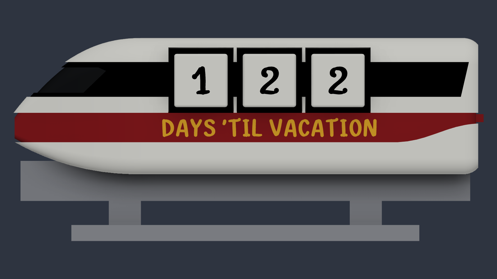
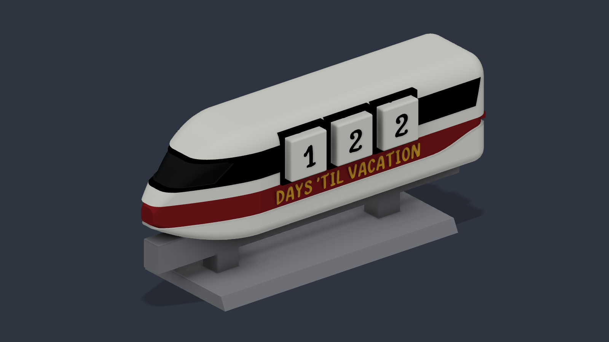
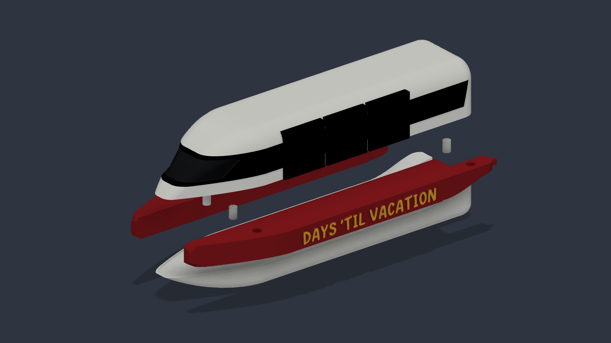

# Monorail Countdown





*Renders from Fusion, in the colours it prints in. A photo of the print will
replace them.*

A Disney monorail desk countdown. Three 20 mm cubes in the window band show the
days left, over **DAYS 'TIL VACATION**; the other side reads **VACATION IS
CALLING!** for when no trip is booked yet. The fourth cube lives in a pocket in
the tail. The car straddles a straight concrete-style beam on two pylons.

Like everything in this repository, it is generated entirely by a Fusion
Python script, starting from an empty document. Nothing is modelled by hand.

## Build it

1. Install this repository's two fonts, `CountdownDigits-Regular.ttf` and
   `CountdownLettering-Regular.ttf` from [`Font/build`](../Font/build), with
   Font Book, then restart Fusion — it reads its font list at launch. Without
   them the script falls back to Waltograph UI, and its report says so.
2. In Fusion, open a new, empty design.
3. **Utilities → Add-ins → Scripts and Add-ins** (Shift+S) → **+** → *Create
   script*, Python. Open its folder and replace the generated `.py` with
   `Monorail Countdown.py`.
4. Click **Run**. It takes from 20 seconds to a couple of minutes, and ends
   with a report of what it built and every check it passed.

Or, with the [ClaudeBridge](../ClaudeBridge) add-in running:

```bash
python3 send.py run "/path/to/Monorail Countdown.py"
```

## What it makes

Twenty-three bodies, 176.6 × 56 × 76 mm assembled.



| Body | What it is | Print it |
|---|---|---|
| `Car_Bottom` | The white belly, up to the red stripe | Belly down |
| `Car_Red_Display` | The display half of the red stripe, with the lettering | On its cut face |
| `Car_Red_Back` | The back half of the red stripe | On its cut face |
| `Car_Top` | White, the black band and frames, white roof, with the cube slots | Standing on its flat bottom |
| `Pin_Red_1`–`2` | Loose pins between the red halves | Standing on end |
| `Pin_Seat_1`–`4` | Loose pins between the red halves and the bottom | Standing on end |
| `Pin_Top_1`–`4` | Loose pins between the red halves and the top | Standing on end |
| `Pin_Beam_1`–`3` | Loose pins, 10 mm long, between the beam and the car | Standing on end |
| `Beam` | The beam and both pylons, one piece | On its side |
| `Foot` | The plate the pylons plug into | Flat |
| `Cube_1`–`Cube_3` | The countdown cubes | A digit face down |
| `Cube_4_Spare` | The fourth cube, kept in the tail | A digit face down |

The car is cut where its colours meet, like the ship's hull and
superstructure, so each part prints in one colour or close to it:

- **The bottom** is all white. Printed belly down, the beam channel is a
  bridge; the nose's underside, which curves up off the bed, is supported.
- **The red stripe** is cut down the middle. Each half lies on its cut face, so
  the gold lettering, which stands on the red, is only the last few layers.
- **The top** prints standing up, so the black band, frames and windshield are
  upright walls, and the cube slots and the spare pocket's roof are bridges.
  The coupler's underside slopes at 45° so it needs no support.

The red stripe is set 0.8 mm into the body, so the bottom's top face has a
ledge round it, as the ship's deck does round its superstructure. Like the
ship, it carries a 0.4 mm locating recess, with 0.1 mm clearance a side, that
both red halves stand in, so a white rim hides the joint, from the tail face,
up the curve of the red's lower edge, to the nose. The top hides its
joint the same way: a white lip 0.4 mm deep covers the red's top edge. The top
prints standing on its underside, where a recess the width of the red would be
a bridge just off the bed, so the red carries a 1.2 mm rib along its edge
instead, which fits a groove behind the lip.

Every joint is pinned, with loose pins in sockets in both parts, so every part
still lies flat on the bed: two between the red halves, two from each red half
to the bottom, two to the top, and three, 10 mm long, from the beam into the
belly. The beam's top runs 5 mm up into the belly, so the channel's sides can
be glued as well.

## Colours

| Filament | What |
|---|---|
| 1 white | The car's body, the pins, the cubes |
| 2 black | Window band, cube frames, tail coupler, windshield, the cube digits |
| 3 red | Stripe, tail lights |
| 4 gold | Lettering |
| 5 grey | Beam and foot |
| 6 PETG | The supports' interface |

Every print file has these six, in this order, so a part imported into another
file's project keeps its colours. No plate uses more than three; when you print
one, map those to your AMS.

Every colour region is a real step in the surface — recessed 0.6–0.8 mm or
raised — never just a painted face, because the slicer's colour fill needs an
edge to stop at. The windshield is recessed one step deeper than the band, so
it still reads as glass in black.

The script also paints the model in Fusion in these colours
(`PREVIEW_COLOURS`). Fusion's 3MF export keeps those colours, but Bambu Studio
does not read them. [`bambu/`](bambu) converts them to Bambu's own painting
and makes ready-to-print files, with each part turned and laid out on its
plate. Otherwise, paint in the slicer.

## Printing

Sliced in Bambu Studio 2.07 for a P1S with a 0.4 mm nozzle, 0.2 mm layers,
PLA, 15% gyroid infill and 4 walls. The dry fit, at 8% lightning and 3 walls,
was too flexible and let light through the white. One car:

| Plate | Time | Filament changes | Filament |
|---|---|---|---|
| Car bottom and pins | 3.1 h | 56 | 46 g, and 8 g PETG |
| Car red halves | 1.6 h | 3 | 46 g |
| Car top | 6.4 h | 122 | 132 g |
| Beam and foot | 1.2 h | 0 | 40 g |
| Cubes (optional) | 3.8 h | 70 | 65 g |

The red plate barely changes colour: the red ends at the stripe's floor and
the letters stand on it, so everything above is gold. The top's changes come
from the black band and frames, which are in every layer from its bottom to
24 mm up, and the bottom's from the PETG under its nose. The changes are paid
per layer, not per part, so batches share them. Per car, measured on full
plates:

| Batch | Per car |
|---|---|
| 4 bottoms a plate | 1.7 h, 41 g with the PETG, 14 changes |
| 5 pairs of red halves a plate | 1.3 h, 42 g |
| 4 tops a plate | 2.9 h, 80 g, 31 changes |

That is about 5.9 h and 163 g a car, pins aside. The earlier car, in two
halves, took 9.8 h and 168 g printed one to a plate at 8% lightning; it was
not measured in batches.

**Supports.** The bottom is supported under the nose, and each red half under
its tail end, which overhangs the spare pocket. Nothing else is: the beam
channel, the cube slots and the pocket's roof are bridges, which print fine,
and support inside them would be hard to clear out. Bambu's own supports
filled those too, so the print files have supports painted on where they are
wanted, and Bambu supports nothing else. The supports' interface is PETG,
which peels cleanly off PLA, in the colour of the parts it holds up, so a stray
strand hides. It costs the bottom plate 56 filament changes, because the
nose's underside meets its supports at almost every height.

**The nose.** The red halves still print on their cut faces, so their nose
curves away from the flank near the top of the print. The nose's width narrows
on a gentler curve than its height, so it leaves the flank more steeply: at
0.2 mm layers the first steps there are 1.9, 1.5 and 1.3 mm wide, where they
were 7.1, 2.3 and 1.8 mm. The top prints standing up, so its nose is an
upright wall.

**Assembly.** Pin and glue the red halves to each other first, so they line
up before they meet anything else. Then pin and glue them into the bottom's
recess, and pin and glue the top on. Glue the pylons into the foot. Last, push
the beam's pins into the beam, and glue the car onto them and along the
channel's sides.

## The cubes

These are the same four cubes as the [Cruise Ship](../Cruise%20Ship)'s — same
size, same digits, same fit — so one set works in either model. You only need
to print them for a second set.

| Cube | Digits |
|---|---|
| `Cube_1` | 1 2 3 4 5 6 |
| `Cube_2` | 0 2 3 4 7 8 |
| `Cube_3` | 0 1 3 5 7 9 |
| `Cube_4_Spare` | 0 1 2 6 8 9 |

Four cubes, not three, because the arithmetic demands it: to show every count
from 000 to 365, the digits 0–3 each need three cubes (000, 111, 222, 333) and
4–9 each need two (344, 355, 266, ...). That is 24 faces, which four cubes
have exactly and three cannot — so no face is blank. The digits are in
[Countdown Digits](../Font), where the 9 is the 6 upside down: there is nothing
to tell apart, since either face reads as a 6 one way up and a 9 the other.
(`MARK_6_AND_9` puts back the small Mickey head that used to mark them.) The
script re-proves all 366 counts every time it runs.

## Changing it

The settings are at the top of the script: the lettering (`CAR_TEXT`), the
fonts (`DIGIT_FONTS`, `TEXT_FONTS`), the fits (`cubeClearance`, `spareClearance`, `beamFit`, `seatGap`, `pinFit`, `socketFit`),
`PREVIEW_COLOURS`, and `SPLIT_CAR` to build the car as one piece. Every layout
rule is checked before anything is built, and again with measurements after:
if a change makes two features collide, the script stops and says which, rather
than quietly building something that will not print.

## Status

Built and checked in Fusion and in the slicer. The car used to print in two
halves, each on its cut face; test prints checked the cube fit, the beam and the
spare pocket. The first one in full colour showed stepped layers where the nose
leaves the flank, red flecks on the white there, and a white line down the
nose where the halves met: each half's first layer takes the colour of its
unpainted cut face. That led to cutting the car along its colours instead.

A dry fit of that, at 8% lightning, sat loosely on the beam and showed gaps
at the joints, and the white was flexible and let light through. Since then
every joint is pinned, the car sits deeper on the beam, the top's joint has a
lip like the bottom's, and the infill is 15% gyroid with 4 walls.

An all-white print of that version fitted together, and the rim hid the
bottom joint along the flat run. On the curve up to the tail the joint showed
as a dark line, because the rim stopped where the curve began. The rim now
runs the whole length, and the next print showed no line anywhere along it.
