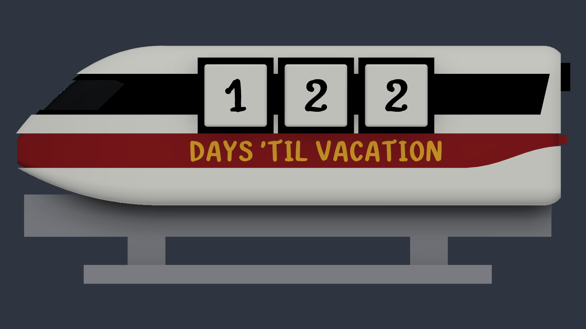
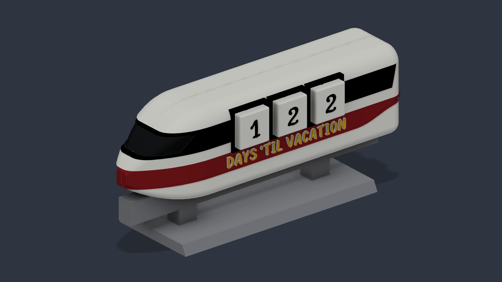

# Monorail Countdown





*Renders from Fusion, in the colours it prints in. A photo of the print will
replace them.*

A Disney monorail desk countdown. Three 20 mm cubes in the window band show the
days left, over **DAYS 'TIL VACATION**; the other side reads **VACATION IS
CALLING!** for when no trip is booked yet. The fourth cube lives in a pocket in
the tail. The car straddles a straight concrete-style beam on two pylons.

Like everything in this repository, it is generated entirely by a Fusion
Python script, starting from an empty document. Nothing is modelled by hand.

## Build it

1. Install this repository's two fonts, `CountdownDigits-Regular.ttf` and
   `CountdownLettering-Regular.ttf` from [`Font/build`](../Font/build), with
   Font Book, then restart Fusion — it reads its font list at launch. Without
   them the script falls back to Waltograph UI, and its report says so.
2. In Fusion, open a new, empty design.
3. **Utilities → Add-ins → Scripts and Add-ins** (Shift+S) → **+** → *Create
   script*, Python. Open its folder and replace the generated `.py` with
   `Monorail Countdown.py`.
4. Click **Run**. It takes from 20 seconds to a couple of minutes, and ends
   with a report of what it built and every check it passed.

Or, with the [ClaudeBridge](../ClaudeBridge) add-in running:

```bash
python3 send.py run "/path/to/Monorail Countdown.py"
```

## What it makes

Eleven bodies, 176.6 × 56 × 76 mm assembled.

| Body | What it is | Print it |
|---|---|---|
| `Car_Display` | The half of the car with the cube slots | Flat on its split face |
| `Car_Back` | The other half | Flat on its split face |
| `Pin_1`–`Pin_3` | Loose pins that line the halves up for gluing | Standing on end |
| `Beam` | The beam and both pylons, one piece | On its side |
| `Foot` | The plate the pylons plug into | Flat |
| `Cube_1`–`Cube_3` | The countdown cubes | A digit face down |
| `Cube_4_Spare` | The fourth cube, kept in the tail | A digit face down |

The car is split down the middle so each half lies flat on its cut face: the
cube slots open upward, the lettering is on the top surface, and nothing
overhangs except a 3.5 mm lip over the beam channel.

## Colours

| | Car (four AMS slots) |
|---|---|
| 1 white | The body |
| 2 black | Window band, cube frames, tail coupler, windshield |
| 3 red | Stripe, tail lights |
| 4 gold | Lettering |

The beam and foot are grey, printed on their own plate. The cubes are white
with black digits.

Every colour region is a real step in the surface — recessed 0.6–0.8 mm or
raised — never just a painted face, because the slicer's colour fill needs an
edge to stop at. The windshield is recessed one step deeper than the band, so
it still reads as glass in black.

The script also paints the model in Fusion in these colours
(`PREVIEW_COLOURS`). Fusion's 3MF export keeps those colours, but Bambu Studio
does not read them. [`bambu/`](bambu) converts them to Bambu's own painting
and makes ready-to-print files, with each part turned and laid out on its
plate. Otherwise, paint in the slicer.

## Printing

Sliced in Bambu Studio 2.07 for a P1S with a 0.4 mm nozzle, 0.2 mm layers and
PLA:

| Plate | Time | Filament changes | Filament |
|---|---|---|---|
| Car halves and pins | 11.1 h | 217 | ~200 g |
| Beam and foot | 1.1 h | 0 | 37 g |
| Cubes (optional) | 3.7 h | 70 | 62 g |

The car plate's changes come from the nose: lying flat, it stands upright, so
its windshield and red lip put three colours in almost every layer. With the
nose and tail plain white it would be about 7.4 h.

With tree supports enabled, the only supports are under the beam channel's lip
and the tail pocket's roof.

**Assembly.** Push the pins into one half's sockets, glue the halves together,
and glue the pylons into the foot. The car lifts on and off the beam; a bump on
top of the beam drops into a notch in the car, so it always sits centred.

## The cubes

These are the same four cubes as the [Cruise Ship](../Cruise%20Ship)'s — same
size, same digits, same fit — so one set works in either model. You only need
to print them for a second set.

| Cube | Digits |
|---|---|
| `Cube_1` | 1 2 3 4 5 6 |
| `Cube_2` | 0 2 3 4 7 8 |
| `Cube_3` | 0 1 3 5 7 9 |
| `Cube_4_Spare` | 0 1 2 6 8 9 |

Four cubes, not three, because the arithmetic demands it: to show every count
from 000 to 365, the digits 0–3 each need three cubes (000, 111, 222, 333) and
4–9 each need two (344, 355, 266, ...). That is 24 faces, which four cubes
have exactly and three cannot — so no face is blank. The digits are in
[Countdown Digits](../Font), where the 9 is the 6 upside down: there is nothing
to tell apart, since either face reads as a 6 one way up and a 9 the other.
(`MARK_6_AND_9` puts back the small Mickey head that used to mark them.) The
script re-proves all 366 counts every time it runs.

## Changing it

The settings are at the top of the script: the lettering (`CAR_TEXT`), the
fonts (`DIGIT_FONTS`, `TEXT_FONTS`), the fits (`cubeClearance`, `spareClearance`, `beamFit`, `pinFit`, `socketFit`),
`PREVIEW_COLOURS`, and `SPLIT_CAR` to build the car as one piece. Every layout
rule is checked before anything is built, and again with measurements after:
if a change makes two features collide, the script stops and says which, rather
than quietly building something that will not print.

## Status

Built and checked in Fusion and in the slicer. The first test print of the
car came out well; a second, with the beam and foot, is under way. Since then
the lettering and digits have moved to this repository's own
[fonts](../Font) and the wording has changed; that version has not been
printed yet.
